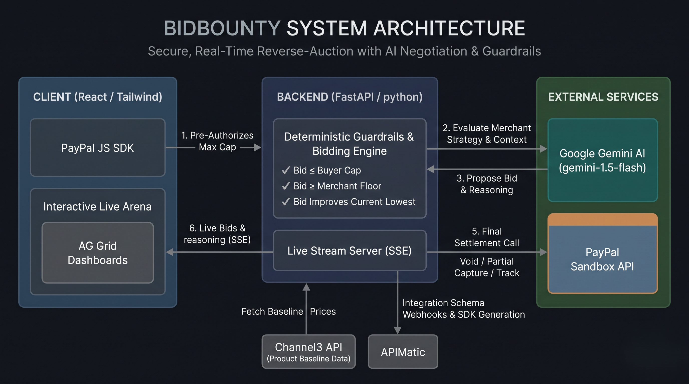

# BidBounty — Autonomous Reverse-Checkout & RFQ Terminal

[](https://paypal.com)
[](https://fastapi.tiangolo.com)
[](https://react.dev)
[](https://ag-grid.com)
[](https://www.apimatic.io)
[](https://channel3.tv)

**Live app:** [bidbounty-frontend.onrender.com](https://bidbounty-frontend.onrender.com)

| Hackathon submission item | Link / status |
| --- | --- |
| Public source repository | [github.com/Unnati061/BidBounty](https://github.com/Unnati061/BidBounty) |
| Open-source license | [MIT License](./LICENSE) — OSI-approved |
| Functional demo | [BidBounty on Render](https://bidbounty-frontend.onrender.com) |
| Backend health check | [bidbounty-backend.onrender.com/api/health](https://bidbounty-backend.onrender.com/api/health) |

> **Elevator Pitch:** E-commerce today is fundamentally broken: buyers waste hours hunting coupon codes and comparing tabs, while retailers pay astronomical advertising fees for uncertain conversions. **BidBounty** flips the entire commerce paradigm through an **Autonomous Reverse-Checkout & Request-For-Quote (RFQ) Terminal**. Instead of browsing static prices, buyers declare their maximum spend cap and lock in a binding PayPal authorization hold. Autonomous merchant agents then compete live in a high-frequency descending auction to capture the guaranteed order without dropping below their private gross margins. Once a winning bid locks in, BidBounty automatically executes a server-guarded partial capture, instantly releases excess funds back to the buyer, and registers package tracking for complete PayPal Seller and Buyer Protection.

---

## System Architecture



---

## AI Integration & Safety — Google Gemini

When `GEMINI_API_KEY` is configured, each live RFQ begins with one server-side **Google Gemini** structured-output request for all three merchants—Apex, SoundWave, and Metro. Gemini receives only the product, retail baseline, buyer cap, merchant listing price, protected floor, and a merchant persona. It returns a proposed target bid and concise customer-visible negotiation rationale for each merchant, which appears in the AG Grid arena as the auction runs.

Gemini proposes; the FastAPI backend decides. Before a proposal can affect the live stream, the backend rejects it unless the bid is below the listing price, at or above that merchant's protected floor, and at or below the buyer's authorized cap. Gemini has no access to PayPal credentials and cannot create, authorize, capture, void, or track a payment. PayPal settlement remains a server-enforced action after the auction winner is determined.

For the **Lowball** scenario, Gemini generates a customer-visible explanation for each merchant's refusal. It cannot change the outcome: FastAPI deterministically verifies that the buyer cap is below every protected floor, then voids the PayPal authorization. This keeps payment release and margin protection non-negotiable while still making the agent reasoning transparent.

If Gemini is unavailable or produces invalid structured output, BidBounty labels and uses a safe, bounded fallback strategy so the functional demo remains available. The fallback is never presented as an AI-generated decision.

---

## PayPal, Sponsor, and Technology Integrations

### 1. PayPal Sandbox APIs (End-to-End Autonomous Settlement)
BidBounty integrates PayPal's v2 Sandbox REST APIs for the complete authorization-to-fulfillment lifecycle:
- **Authorize Intent (`POST /v2/checkout/orders`)**: Initializes orders with `intent: "AUTHORIZE"` bound to the buyer's maximum spend cap (e.g., \$240.00). The buyer guarantees liquidity without any upfront debit.
- **Order Authorization (`POST /v2/checkout/orders/{id}/authorize`)**: Executed via the real `@paypal/react-paypal-js` modal. Locks an honor-period hold for the full amount and unlocks private RFQ quoting for merchant bots.
- **Server-Enforced Partial Capture (`POST /v2/payments/authorizations/{id}/capture`)**: A backend server guardrail validates that `winning_bid <= buyer_cap`. It executes a partial capture for the exact validated winning price with `final_capture: true`, and calculates the release as `buyer_cap - winning_bid`.
- **Instant Void Protection (`POST /v2/payments/authorizations/{id}/void`)**: If a buyer submits a lowball bounty below all merchant reserve margins (e.g., \$195.00), all merchant bots refuse, triggering an automatic void request. The buyer is charged \$0.00 with immediate hold release.
- **Proof of Fulfillment (`POST /v2/checkout/orders/{id}/track`)**: Automatically registers tracking information (carrier: `FEDEX`, mock tracking number) with PayPal to maintain Seller Protection eligibility.

### 2. AG Grid (Custom-Engineered Real-Time Trading Terminal)
The live bidding terminal uses **AG Grid React** customized to match our dark `#08090C` / `#0F1117` terminal aesthetic:
- **Built-in Animated Row Reordering**: Uses `animateRows={true}` and `getRowId` mapped to persistent merchant IDs (`apex`, `wave`, `metro`). When an agent places a new lowest bid, AG Grid smoothly animates the row to the top position.
- **Custom Cell Renderers**:
  - `MerchantCellRenderer`: Renders `MiniRobot` status avatars and live gross margin percentages.
  - `PriceFloorTrackCellRenderer`: Dynamic SVG track with hard floor ticks, buyer spend cap tick, list price indicators, and smooth animated bid sliders.
  - `ReasoningCellRenderer`: Geist Sans typewriter animation streaming the autonomous thought processes of each agent in real time.
  - `LiveBidCellRenderer`: Custom `OdometerPrice` rolling number wheels paired with animated delta discount chips (`-$5.50`).
  - `StatusCellRenderer`: Semantic state badges (`Standby`, `Leading`, `Floor reached`, `Winner`, `BELOW_FLOOR_MARGIN`).

### 3. APIMatic (Merchant SDK & OpenAPI 3.0 Webhook Spec)
To empower any third-party merchant to deploy an autonomous bidding bot:
- Created [`merchant-webhook-openapi.yaml`](./merchant-webhook-openapi.yaml), a complete OpenAPI 3.0 specification defining the `POST /v1/bounty/evaluate` webhook contract.
- External merchants receive incoming RFQ events (`bounty_id`, `product_id`, `buyer_cap`, `current_lowest_bid`) and respond with autonomous bid decisions (`bid_price`, `merchant_margin`, `status`).
- The OpenAPI document can be imported into APIMatic CodeGen to generate idiomatic Python, TypeScript, Java, C#, and Go SDKs with documentation.
- Integrated a direct "View Merchant SDK & Docs (Powered by APIMatic)" portal directly inside the `MerchantStudio` UI.

### 4. Channel3 (Catalog-Oriented Product Experience)
- The Channel3-oriented catalog model drives dynamic product switching across 3 distinct consumer categories:
  1. **Sony WH-1000XM5** (Retail: \$251.00 · Wholesale Base: \$200.00 · Default Cap: \$240.00)
  2. **Dell U3223QE 4K Monitor** (Retail: \$450.00 · Wholesale Base: \$380.00 · Default Cap: \$410.00)
  3. **Herman Miller Aeron** (Retail: \$1200.00 · Wholesale Base: \$950.00 · Default Cap: \$1050.00)
- `GET /api/product` and `GET /api/bounty/stream` provide the product context used by the auction. The repository ships seeded catalog baselines so the demo is reproducible without a third-party catalog key.

### 5. Render (Production Deployment)
- Render hosts the public [Vite + React frontend](https://bidbounty-frontend.onrender.com) and the FastAPI/SSE backend.
- [`render.yaml`](./render.yaml) declares both services, production build commands, health checks, frontend-to-backend routing, and server-only secret placeholders for PayPal and Gemini.
- Set `GEMINI_API_KEY` only on the Render backend service. It is never exposed to the browser or committed to this repository.

### Core Technologies
- **Frontend:** React 19, Vite, Tailwind CSS, Lucide React
- **Live terminal:** AG Grid React, custom renderers, Server-Sent Events (SSE)
- **Backend:** Python, FastAPI, Pydantic, HTTPX, `sse-starlette`
- **Payments:** PayPal JavaScript SDK and PayPal v2 Sandbox REST APIs
- **AI:** Google Gemini structured JSON output with server-side validation and a bounded fallback

---

## Quickstart & Local Setup

### Prerequisites
- **Node.js**: v18.0.0 or higher
- **Python**: v3.10 or higher
- **Git**

### 1. Clone the Repository
```bash
git clone https://github.com/Unnati061/BidBounty.git
cd BidBounty
```

### 2. Configure Environment Variables
Copy `.env.example` to `.env` in the root directory:
```bash
cp .env.example .env
# Windows PowerShell: Copy-Item .env.example .env
```
Fill in your PayPal Sandbox Developer credentials:
```env
PAYPAL_CLIENT_ID=your_paypal_sandbox_client_id
PAYPAL_CLIENT_SECRET=your_paypal_sandbox_client_secret
PAYPAL_ENV=sandbox

# Required for Gemini-guided merchant strategies. Keep this server-side.
GEMINI_API_KEY=your_google_ai_studio_api_key
GEMINI_MODEL=gemini-2.5-flash

VITE_PAYPAL_CLIENT_ID=your_paypal_sandbox_client_id
VITE_API_BASE_URL=http://localhost:8000
```

### 3. Start the FastAPI Backend
```bash
# Create and activate virtual environment (optional)
python -m venv venv
source venv/bin/activate  # On Windows: .\venv\Scripts\activate

# Install dependencies
pip install -r backend/requirements.txt

# Launch FastAPI server
python -m uvicorn backend.main:app --host 0.0.0.0 --port 8000 --reload
```
The backend will be live at `http://localhost:8000`. You can test health via `http://localhost:8000/api/health` and browse Swagger docs at `http://localhost:8000/docs`.

### 4. Start the Vite React Frontend
In a new terminal window:
```bash
# Install frontend dependencies
npm install

# Launch Vite dev server
npm run dev
```
Open **[http://localhost:5173](http://localhost:5173)** in your browser.

### 5. Verify the Build and Services
```bash
# Frontend production build
npm run build

# Backend health check (with the backend running)
curl http://localhost:8000/api/health
```

For the hosted demo, visit the [Render frontend](https://bidbounty-frontend.onrender.com). The backend health endpoint reports whether a Gemini key is configured; it never returns the key itself.

### Demo Access Without a PayPal Sandbox Login
The gold **PayPal** button opens the real PayPal Sandbox authorization flow and is the path to use when testing with a Sandbox buyer account. For a fast, login-free product demonstration, click the cyan **Authorize** button beside it. This starts the app's in-product demo authorization flow so judges can run the Gemini auction, settlement UI, and Lowball void scenario without logging in to PayPal. It is for demonstration only and is not a replacement for a buyer-approved PayPal authorization.

---

## Demo Walkthrough & Testing Scenarios

BidBounty features preset scenarios in the top navigation bar:

1. **Happy Path — Multi-Agent Price Drop**:
   - Select the **Sony WH-1000XM5** with Max Spend Cap at **\$240.00**.
   - Click the gold **PayPal** button to authorize with a Sandbox buyer account, or use the cyan **Authorize \$240.00** button for the login-free in-product demo flow.
   - Watch the 6-tick Gemini-guided bidding stream. The exact eligible bids and winner may vary because Gemini proposes merchant strategies at runtime; server guardrails reject any proposal outside the buyer cap, listing-price, or merchant-floor rules.
   - Notice the **Settlement Stepper**:
     - Step 1: Pre-authorized hold for the selected buyer cap.
     - Step 2: Partial capture for the actual validated winner.
     - Step 3: The stepper and Deal Locked toast calculate the excess release and savings from that same live capture amount.
   - Package tracking is registered with the sandbox tracking number `SIM-SBX-443844607820`.
   - "Deal Locked" displays live capture, release, and savings values for Sony, Dell, and Aeron.

2. **Lowball Path — Automatic Void**:
   - Toggle the **Scenario** switch to **Lowball**.
   - Spend cap drops to **\$195.00** (below all merchant reserve floors: \$220, \$224, \$229).
   - Authorize the bounty. The bots evaluate the cap against their margins and instantly refuse (`BELOW_FLOOR_MARGIN`).
   - The backend triggers `POST /v2/payments/authorizations/{id}/void`, canceling the hold and charging the buyer **\$0.00**.

3. **Multi-Product Selection**:
   - Use the dropdown in the Hero bar to switch to the **Dell U3223QE 4K Monitor** (\$410 cap) or **Herman Miller Aeron** (\$1050 cap).
   - Notice how the Price Floor Track slider, wholesale base, and agent floors dynamically recalibrate for each category.

4. **Live Audit Ledger & Studio**:
   - Click **PayPal Logs** in the header to view the live JSON payloads of all PayPal REST calls.
   - Click **Merchant Studio** to adjust merchant floor margins or review the APIMatic OpenAPI webhook specification.

---

## Project Structure

```
BidBounty/
├── docs/
│   └── architecture.png            # System architecture diagram
├── backend/
│   ├── main.py                     # FastAPI app: PayPal v2, Gemini guardrails, SSE generator
│   └── requirements.txt            # Python dependencies
├── src/
│   ├── components/
│   │   ├── ArenaHeader.jsx         # Live lowest bid, savings counter, 3-step stepper
│   │   ├── BiddingTable.jsx        # AG Grid terminal with 5 custom cell renderers
│   │   ├── DealToast.jsx           # Animated deal locked confirmation toast
│   │   ├── Header.jsx              # App header, view toggle & scenario selector
│   │   ├── HeroProductBar.jsx      # Channel3 dropdown, cap input & PayPal SDK buttons
│   │   ├── MerchantStudio.jsx      # Merchant floor configurations & APIMatic portal
│   │   ├── MiniRobot.jsx           # SVG animated merchant bot avatar
│   │   ├── OdometerPrice.jsx       # Rolling digit price odometer animation
│   │   ├── PayPalLogs.jsx          # Live REST API audit logging table
│   │   ├── PrecisionRobot.jsx      # Detailed robot illustration
│   │   └── TypewriterThought.jsx   # Geist Sans typewriter thought stream
│   ├── data/
│   │   └── merchants.js            # Merchant initial states and margin helpers
│   ├── App.jsx                     # Master state machine & PayPal orchestration
│   ├── index.css                   # AG Grid dark theme overrides & hairline borders
│   └── main.jsx                    # React root entry point
├── merchant-webhook-openapi.yaml   # APIMatic OpenAPI 3.0 specification
├── render.yaml                     # Production deployment blueprint
├── package.json                    # Frontend dependencies & scripts
├── tailwind.config.js              # Custom Tailwind configuration
└── vite.config.js                  # Vite bundler configuration
```

---

## License

This project is released under the [MIT License](./LICENSE), an OSI-approved open-source license.

## Acknowledgments

Built for the **PayPal AI Hackathon 2026**. BidBounty uses PayPal, Google Gemini, AG Grid, APIMatic, Channel3-oriented catalog data, and Render as described above.
